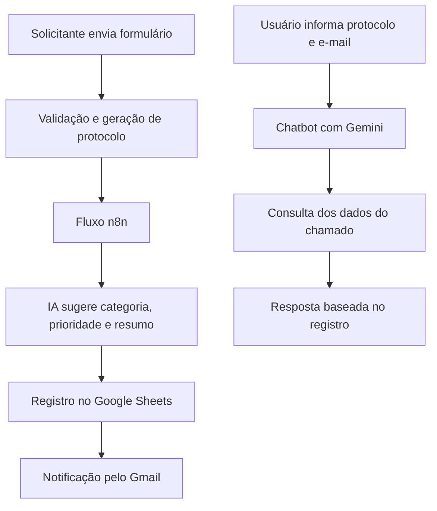

# 01 — Criação de agentes de Inteligência Artificial

## 1. Contexto

Na Unidade IV, o projeto de triagem de chamados foi ampliado para utilizar serviços de IA em etapas de interpretação e atendimento. A solução combina automação de processos com modelos de linguagem, em vez de depender de um único agente que tome todas as decisões.

É importante diferenciar o agente conversacional do fluxo automatizado: o n8n coordena etapas e integrações; os modelos de IA interpretam informações e produzem sugestões; e a aplicação apresenta os recursos ao usuário.

## 2. Agentes e responsabilidades identificados

### 2.1 Agente de apoio à triagem

**Finalidade:** analisar a descrição enviada pelo solicitante e produzir uma sugestão estruturada para auxiliar a equipe de suporte.

**Entradas esperadas:**
- descrição do problema;
- informações de identificação e contato solicitadas pelo formulário;
- contexto fornecido pelo fluxo de automação.

**Resultados esperados:**
- categoria ou tipo de solicitação;
- prioridade sugerida;
- resumo do problema;
- orientação inicial.

**Limite:** a saída do modelo é uma recomendação. Não deve ser considerada diagnóstico definitivo nem substituir a avaliação da equipe responsável.

### 2.2 Agente conversacional de acompanhamento

**Finalidade:** permitir que o solicitante consulte informações do chamado por meio de uma conversa.

**Entradas principais:** protocolo do chamado e e-mail informado no cadastro.

**Responsabilidades:**
- interpretar a pergunta do usuário;
- consultar os dados disponíveis para localizar o chamado;
- apresentar o andamento conforme o registro encontrado;
- orientar o usuário sobre as informações necessárias;
- encaminhar ou registrar informações adicionais conforme o fluxo configurado.

**Limite:** o chatbot deve responder com base nos dados consultados, sem inventar status, prazos ou ações que não estejam registrados.

## 3. Fluxo simplificado

## 4. Critérios de qualidade

Um agente adequado ao contexto deve:
- manter foco na finalidade de triagem ou consulta;
- solicitar os dados mínimos necessários;
- reconhecer quando não possui informação suficiente;
- evitar inventar dados ou afirmar que uma ação foi concluída sem confirmação;
- tratar falhas de integração de maneira controlada;
- permitir revisão humana das sugestões;
- respeitar a privacidade e a finalidade do tratamento dos dados.

## 5. Papel humano

A equipe de suporte continua responsável por avaliar a solicitação, confirmar a prioridade, corrigir classificações inadequadas e decidir as providências. A IA atua como ferramenta de apoio para organizar informações e agilizar tarefas repetitivas.

## 6. Evidências e estado de validação

A arquitetura e as responsabilidades acima foram descritas com base nos recursos documentados do projeto colaborativo. A confirmação do comportamento real de cada agente exige executar os fluxos no n8n com as credenciais configuradas e verificar as respostas e registros produzidos. Este documento não declara que todos os cenários foram executados ou aprovados.

**Repositório de implementação:** [Sistema de Triagem Automática — Vibe Coder](https://github.com/DouglasSM13/Sistema-de-Triagem-automatica---Vibe-Coder)
