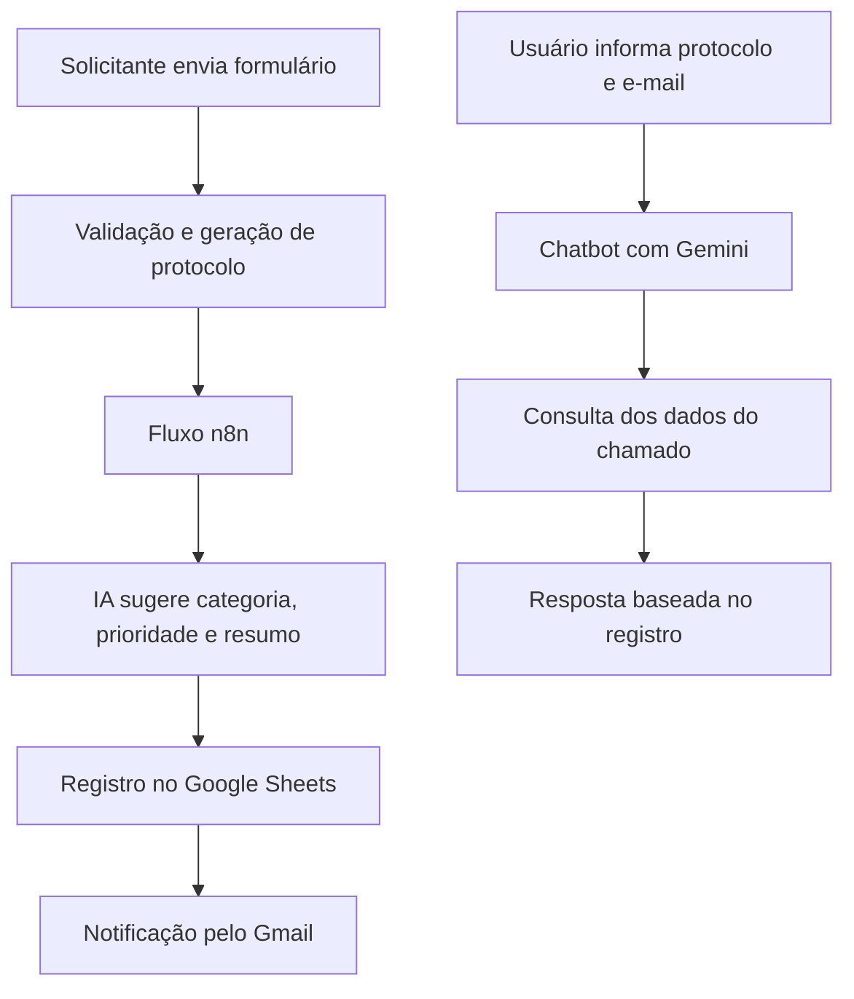

# 01 — Criação de agentes de Inteligência Artificial

## 1. Contexto

Na Unidade IV, o projeto de triagem de chamados utiliza automação de processos e modelos de linguagem em funções distintas. O n8n coordena os fluxos e as integrações; o componente de IA de triagem sugere uma classificação estruturada; e o assistente Gemini permite conversar sobre o andamento do chamado. Não se trata de um único agente com autonomia para executar todas as etapas.

É importante diferenciar o agente conversacional do fluxo automatizado: o n8n coordena etapas e integrações; os modelos de IA interpretam informações e produzem sugestões; e a aplicação apresenta os recursos ao usuário.

## 2. Agentes e responsabilidades identificados

### 2.1 Agente de apoio à triagem

**Finalidade:** analisar a descrição enviada pelo solicitante e produzir uma sugestão estruturada para auxiliar a equipe de suporte. Na arquitetura documentada, essa etapa utiliza um Basic LLM Chain com modelo OpenAI e Structured Output Parser, orquestrados pelo n8n.

**Entradas esperadas:**
- descrição do problema;
- informações de identificação e contato solicitadas pelo formulário;
- contexto fornecido pelo fluxo de automação.

**Resultados esperados:**
- categoria ou tipo de solicitação;
- prioridade sugerida;
- resumo do problema;
- orientação inicial.

**Limite:** a saída do modelo é uma recomendação. O fluxo prevê valores de fallback quando a IA falha ou devolve uma resposta inválida. A sugestão não deve ser considerada diagnóstico definitivo nem substituir a avaliação da equipe responsável.

### 2.2 Agente conversacional de acompanhamento

**Finalidade:** permitir que o solicitante consulte informações do chamado por meio de uma conversa.

**Entradas principais:** protocolo, e-mail utilizado na abertura, mensagem e identificador de sessão enviados pela interface web. O fluxo n8n busca o registro no Google Sheets e confere a correspondência do e-mail antes de encaminhar os dados do chamado ao Gemini.

**Responsabilidades:**
- interpretar a pergunta do usuário;
- responder com base nos dados do chamado previamente localizado e validado pelo fluxo n8n;
- apresentar o andamento conforme o registro encontrado;
- orientar o usuário sobre as informações necessárias;
- encaminhar ou registrar informações adicionais conforme o fluxo configurado.

**Limites:** a busca e a verificação dos dados são realizadas por etapas do n8n; o modelo Gemini não deve receber acesso irrestrito à planilha. O assistente responde com base no registro localizado, não altera status, prioridade ou responsável e não deve inventar prazos ou ações que não estejam registrados. Informações adicionais podem ser registradas pelo fluxo para avaliação da equipe.

## 3. Fluxo simplificado

## 4. Critérios de qualidade

Um agente adequado ao contexto deve:
- manter foco na finalidade de triagem ou consulta;
- solicitar os dados mínimos necessários;
- reconhecer quando não possui informação suficiente;
- evitar inventar dados ou afirmar que uma ação foi concluída sem confirmação;
- tratar falhas de integração de maneira controlada;
- permitir revisão humana das sugestões;
- respeitar a privacidade e a finalidade do tratamento dos dados.

## 5. Papel humano

A equipe de suporte continua responsável por avaliar a solicitação, confirmar a prioridade, corrigir classificações inadequadas e decidir as providências. A IA atua como ferramenta de apoio para organizar informações e agilizar tarefas repetitivas.

## 6. Evidências e estado de validação

Em 27/11/2026, o usuário relatou uma execução em que o chatbot respondeu à pergunta sobre o andamento do chamado com o status **Aberto**. Essa evidência confirma uma interação funcional relatada, mas não comprova todos os cenários do assistente, a segurança contra consultas indevidas ou o funcionamento de todos os nós. A arquitetura e as responsabilidades acima foram descritas com base nos recursos documentados do projeto colaborativo. Este documento não declara que todos os cenários foram executados ou aprovados.

**Repositório de implementação:** [Sistema de Triagem Automática — Vibe Coder](https://github.com/DouglasSM13/Sistema-de-Triagem-automatica---Vibe-Coder)
