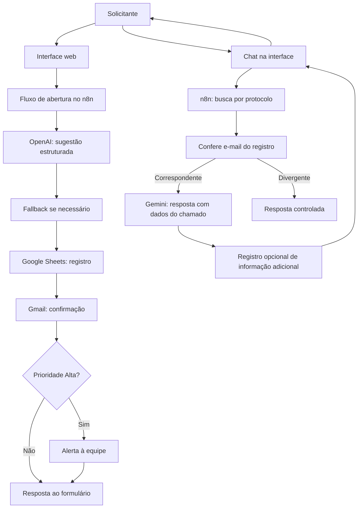

# 05 — Projeto de solução inteligente

## 1. Nome do projeto

**Sistema de Triagem Automática de Chamados de Suporte**

Projeto colaborativo desenvolvido por Nathan Ferreira dos Santos e Douglas, com foco na organização de solicitações de suporte de Tecnologia da Informação.

## 2. Problema

Solicitações de suporte podem chegar com descrições incompletas e sem padronização. Isso dificulta a identificação do tipo de problema, a organização dos registros e a definição de prioridade.

A proposta é utilizar uma interface web, automação e IA generativa para apoiar a abertura, a classificação inicial e o acompanhamento dos chamados.

## 3. Solução proposta

A aplicação reúne dois caminhos principais:

### Abertura e triagem
1. O usuário preenche o formulário web.
2. Os dados são validados e um protocolo é gerado.
3. O n8n valida e normaliza os dados, gera o protocolo e encaminha a descrição ao componente de IA (Basic LLM Chain com modelo OpenAI e saída estruturada) para sugerir categoria, prioridade, resumo e orientação inicial.
4. Se a IA falhar ou produzir uma saída inválida, o fluxo prevê valores de fallback; em seguida, o chamado é encaminhado ao Google Sheets.
5. O Gmail envia uma confirmação ao solicitante e o fluxo prevê uma ramificação de alerta para chamados de prioridade alta.

### Consulta pelo chatbot
1. O usuário acessa o chatbot.
2. Informa protocolo e e-mail.
3. O webhook do n8n pesquisa o chamado no Google Sheets e confere se o e-mail informado corresponde ao registro.
4. Somente após essa verificação, os dados do chamado são encaminhados ao assistente Gemini, que interpreta a pergunta e responde com base no registro.
5. O fluxo pode registrar informações adicionais enviadas pelo usuário; o assistente não altera status, prioridade ou responsável.

## 4. Arquitetura tecnológica

| Componente | Tecnologia | Responsabilidade |
|---|---|---|
| Interface web | HTML, CSS e JavaScript | Formulário e interação com o usuário |
| Automação | n8n Cloud | Orquestração dos fluxos e integrações |
| IA para triagem | OpenAI | Apoio à interpretação e classificação |
| Chatbot | Gemini | Conversação sobre os dados do chamado previamente localizado e validado pelo n8n |
| Armazenamento | Google Sheets | Registro dos chamados |
| Notificações | Gmail | Confirmações e alertas |
| Hospedagem da interface | Vercel | Disponibilização da aplicação web |

A tabela descreve a arquitetura registrada no projeto. A execução de cada integração depende da configuração vigente dos serviços e das credenciais correspondentes.

## 5. Diagrama conceitual

## 6. Relação com os conteúdos da Unidade IV

- **Agentes de IA:** utilização de modelos para interpretar solicitações e apoiar o atendimento.
- **Chatbot:** interface conversacional para consulta de chamados.
- **Ferramentas de integração:** n8n conecta interface, modelos de IA, planilha e e-mail.
- **IA generativa:** modelos de linguagem produzem interpretações e respostas a partir do contexto recebido.
- **Limitações:** dependência de serviços externos, erros de interpretação e necessidade de dados atualizados.
- **Ética:** revisão humana, privacidade, prevenção de vieses e transparência.

## 7. Demonstração

- [Aplicação publicada na Vercel](https://sistema-de-triagem-automatica.vercel.app/)
- [Repositório original do projeto colaborativo](https://github.com/DouglasSM13/Sistema-de-Triagem-automatica---Vibe-Coder)

Este é o endereço confirmado pelo responsável como a versão testada e documentada em 27/11/2026. A disponibilidade deve ser conferida novamente no momento da apresentação.

## 8. Resultados de testes relatados

Em 27/11/2026 foram relatadas duas execuções na aplicação publicada:

| Execução | Resultado observado | Evidência relatada |
|---|---|---|
| Abertura sobre falha na saída de produtos do sistema de coleta | Categoria Software; prioridade Média; protocolo `CH-20261126-P725`; resumo e sugestão inicial exibidos. | Confirmação apresentada pela página e e-mail de confirmação recebido. |
| Abertura sobre instabilidade/queda de internet em todo o setor | Categoria Rede/Internet; prioridade Alta; protocolo `CH-20261126-VCTH`; sugestão inicial exibida. | O usuário confirmou o recebimento do e-mail de confirmação. |

**Confirmação do mantenedor:** após os testes relatados, Douglas confirmou ao responsável pela documentação que a gravação no Google Sheets, o alerta interno de prioridade alta e os workflows no n8n estão funcionando. Essa informação é uma confirmação do mantenedor repassada por Nathan, não uma inspeção independente desta documentação. A exportação e o versionamento dos workflows JSON ainda precisam ser comprovados no repositório. Outros cenários de teste continuam pendentes. O registro detalhado está na [matriz de casos de teste da contribuição ao repositório colaborativo](https://github.com/DouglasSM13/Sistema-de-Triagem-automatica---Vibe-Coder/blob/docs/auditoria-testes-seguranca/docs/casos-de-teste.md).

## 9. Divisão de responsabilidades e autoria

O projeto é colaborativo. O repositório de Douglas contém a implementação original e é o local em que o desenvolvimento e as atualizações técnicas continuam. Esta documentação acadêmica organiza a apresentação da Unidade IV no repositório pessoal de Nathan e referencia o trabalho conjunto, sem reivindicar autoria exclusiva.

## 10. Roteiro curto para apresentação

1. Apresentar o problema: dificuldade de organizar e acompanhar chamados de TI.
2. Mostrar a interface de abertura e explicar a geração do protocolo.
3. Explicar como a IA sugere categoria, prioridade e resumo.
4. Mostrar como os dados são registrados e como ocorrem as notificações.
5. Apresentar a especificação do chatbot e explicar por que ela não foi implementada nesta etapa.
6. Apresentar limitações: erros da IA, dependência de integrações e atualização dos registros.
7. Concluir destacando a supervisão humana, a privacidade e a responsabilidade no uso da IA.
